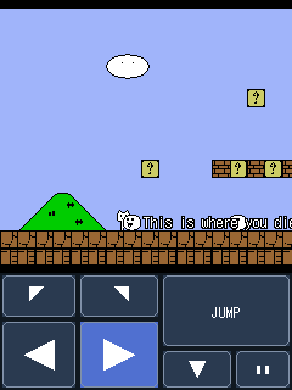
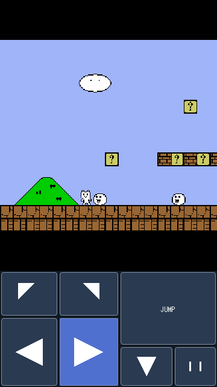

# OpenSyobonJ2ME

Syobon Action (しょぼんのアクション, Cat Mario) for Java ME phones: a port of
[Open Syobon Action](https://github.com/angelXwind/OpenSyobonAction) that runs on
anything from 2002-era MIDP 1.0 phones with 64 KB jar limits up to MIDP 2.0
touchscreens, on screens from 128x128 to 360x640.

   
  
 

## Download

Grab the jar (and jad, if your phone wants one) from [Releases](../../releases):

| Jar | Screens | View | Sound | Size |
|---|---|---|---|---|
| `OpenSyobonJ2ME.jar` | 240x320 and up (touch and stretch included) | 240x210 | music + effects | ~795 KB |
| `OpenSyobonJ2ME-lite.jar` | same | 240x210 | effects | ~225 KB |
| `OpenSyobonJ2ME-208.jar` | 208x208, 176x208, 176x220 | 160x140 | effects | ~112 KB |
| `OpenSyobonJ2ME-128.jar` | 128x128, 128x160 | 120x105 | effects | ~110 KB |
| `OpenSyobonJ2ME-midp1-176.jar` | MIDP 1.0, 176x208 and up | 160x140 | effects if the phone has MMAPI | ~225 KB |
| `OpenSyobonJ2ME-midp1-128.jar` | MIDP 1.0, 128x128 and up | 120x105 | none | ~58 KB |

Which one: MIDP 2.0 phones (most phones from 2004 on) take the first four, picked by
screen size. The 208 and 128 builds draw the game at a third and a quarter of the
original size, use a 10px font, wrap the hint-box text to fit, and leave out the three
long jingles (goal, 4-clear, all-clear) to stay near the 128 KB JAR limit of older
Series 40 phones.

The `midp1` builds are for phones that only have MIDP 1.0 and CLDC 1.0: Series 40 1st
edition Nokias (3100, 6610, 7210, 7250...), early S60 (7650, 3650, N-Gage), and older
Sony Ericsson, Siemens and Motorola phones. `midp1-128` stays under the 64 KB jar
limit of the early Series 40 phones, so it is silent. `midp1-176` is for roomier
phones such as early S60, and plays the sound effects when the phone has MMAPI. On
Nokias they use the Nokia UI API's full-screen canvas; on other phones the pause menu
sits behind a **Menu** soft key. They have no rotation, stretch or touch pad (MIDP 1.0
lacks the calls behind them), and they skip up to three pictures in four on slow
phones so the game itself keeps full speed. MIDP 1.0 doesn't require phones to support
PNG transparency; nearly all do, but if sprites show coloured boxes around them, that's
why.

## Language

The game comes in Japanese and English. It starts in Japanese if the phone's locale is
Japanese and in English otherwise; switch under **Language** in the pause menu. The
English text (hint blocks, death lines, credits) lives in `tools/en.txt`, one line per
original string, so adding another language is a matter of copying that file.

## Controls

| | Keys |
|---|---|
| Move | 4 / 6 or d-pad left/right |
| Jump | 2, 5, d-pad up or centre key |
| Jump while moving | 1 / 3 |
| Down (pipes) | 8 or d-pad down |
| Down while moving | 7 / 9 |
| Self-destruct | 0 |
| Double speed (hold) | # |
| Back to title | * |
| Pause menu | either soft key |

On the title screen, left/right picks the stage (1-1 to 3-1, plus `?`, the random
"mystery dungeon") and 5 starts.

Most S40 keypads only register one key at a time, which is why 1/3/7/9 combine a
direction with jump or down.

### Touch

On touchscreen phones the 240 builds put a pad under the picture: left/right, jump,
jump-left/jump-right (so one finger can run and jump; Series 40 touch is single-touch),
down and pause. Slide between buttons without lifting. On the title screen, tap the
picture or JUMP to start. In the pause menu, tap a row to change it and tap outside the
box to close. **Touch pad** in the menu turns it on or off; Auto shows it whenever the
phone reports a touchscreen. The pad only appears in portrait/Auto.

### Stretch

**Stretch** scales the picture up to fill bigger screens (nearest-neighbour, aspect
kept), in portrait or either landscape mode. Auto stretches only when the picture would
grow by at least 1.4x, Off never does, On always fills the screen. Stretching redraws the
whole picture by hand every frame, so turn it off if a phone feels slow with it.

### Portrait or landscape

Set it under **Screen** in the pause menu:

- **Auto**: upright, using the screen as it is (portrait on 240x320, landscape on 320x240)
- **Portrait**
- **Landscape (keys right)**: turn the phone anticlockwise, keypad on the right
- **Landscape (keys left)**: turn it clockwise

In landscape the keys rotate with the picture, so whichever key points "up" on screen
jumps. The setting is saved.

## Sound

All audio is 8 kHz 8-bit mono WAV converted from the original OGGs. The dungeon track
held its loop twice, so only one copy is kept.

Plenty of S40 phones can only play one sampled sound at a time. When the phone reports
`supports.mixing=false`, the pause menu offers **music first** (default: music plays and
only the death, goal and clear jingles cut in, the same places the original stops the
music) or **effects first** (no music, every sound effect).

## Differences from the PC version

- The original 480x420 game logic runs unchanged and is drawn at 1/2, 1/3 or 1/4 scale
  depending on the build, so physics and traps behave the same everywhere.
- Sprites are redrawn for each scale by a pixel-art reduction that keeps outlines and
  small features. The player's cat is hand-drawn at every scale, and on the 128 build
  the ground, brick, question, hard and used blocks and the white blob enemy are too.
- Japanese text uses Sazanami Gothic's 12px (10px on small builds) bitmap glyphs,
  pre-rendered into the jar, so no CJK font is needed on the phone.
- Hint-block message boxes span the full width so the text fits, and stay up while
  the game waits for a key (the SDL port showed an empty box there).
- Number-key stage select is replaced by left/right on the title screen.
- English translation, touch pad and stretching are new.

## Building

Needs a JDK (21 works), Python 3 with Pillow, ffmpeg, git and curl.

```sh
./build.sh            # build/OpenSyobonJ2ME.jar + .jad
LITE=1 ./build.sh     # build/OpenSyobonJ2ME-lite.jar + .jad
SCALE=3 ./build.sh    # build/OpenSyobonJ2ME-208.jar + .jad
SCALE=4 ./build.sh    # build/OpenSyobonJ2ME-128.jar + .jad
MIDP=1 SCALE=4 ./build.sh   # build/OpenSyobonJ2ME-midp1-128.jar + .jad
MIDP=1 SCALE=3 ./build.sh   # build/OpenSyobonJ2ME-midp1-176.jar + .jad (MUSIC=1 adds music)
./tools/smoke.sh [jar]  # boots a jar headless in FreeJ2ME, screenshots in build/smoke/
```

The first build runs `tools/fetch-deps.sh`, which pulls into `deps/`: Open Syobon Action
(game source and assets, pinned commit), FreeJ2ME (its `javax.microedition` classes are
the API we compile against, and it runs the smoke test), and ProGuard 7.4.2.

What the build does:

1. `tools/extract_stages.py` moves the stage tile arrays out of `main.cpp` into
   `/st/*.bin`; initialisers that big would overflow Java's 64 KB method limit.
2. `tools/convert.py` translates the C++ game logic into `G.java`, and `tools/patch.py`
   applies the hand fixes on top.
3. `javac -source 8 -target 8`, refusing any non-CLDC API (StringBuilder, boxing, class
   literals), then ProGuard with `-microedition` shrinks and preverifies (class files
   for Java 1.4, or 1.1 for MIDP 1.0). The shipped classes are checked again: MIDP 1.0
   builds fail if anything uses MIDP 2.0 calls or floating point. The game's fire bars
   use an integer sine table instead of `Math.sin`, so no build needs floats.
4. `tools/sprites.py`, `tools/font.py` and ffmpeg generate the sprites, font and WAVs
   for the chosen scale; `build.sh` writes the scale into a generated `Cfg.java`.

Shared runtime in `src/java/syobon/`: `Rt` stands in for DxLib/SDL, `Snd` handles
MMAPI audio and `Font` draws the bitmap font. `src/midp2/` holds the MIDP 2.0 canvas
(`Cv`: main loop, keys, touch pad, rotation, stretch, pause menu) and `src/midp1/` the
MIDP 1.0 one (`Eng` plus a plain and a Nokia full-screen canvas).

GitHub Actions builds all six jars on every push and attaches them to a release when a
`v*` tag is pushed.

## Credits

- Syobon Action: Chiku (ちく). If you pass this around, credit Chiku.
- Open Syobon Action (SDL port): Mathew Velasquez; fork by Karen (angelXwind)
- Sazanami Gothic font: Electronic Font Open Laboratory (/efont/) and contributors
- J2ME port: Jecka

The game's music is taken from other games, as in the original release.

## License

The code in this repository (runtime, MIDP 1 and 2 canvases, build scripts and tools,
English translation, hand-drawn sprites, touch pad) is © Jecka, licensed under the
[GNU General Public License v3.0](LICENSE) or later.

That license doesn't extend to Syobon Action itself or to the Open Syobon Action source
and assets the build downloads (game code, graphics, sound, music). Those belong to
their respective authors and come with no license of their own.
