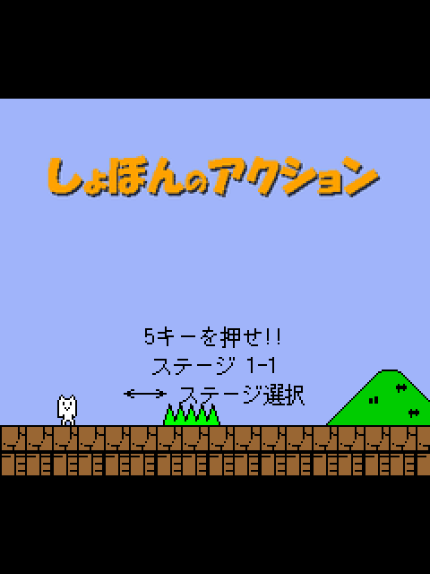
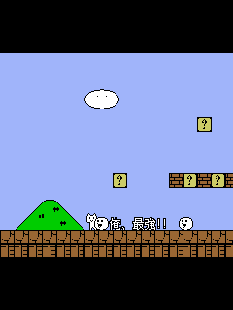
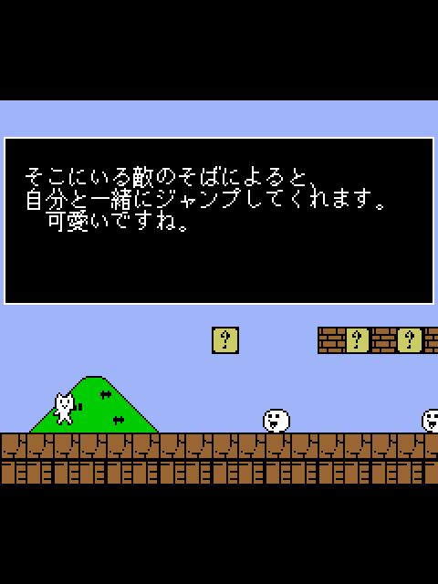
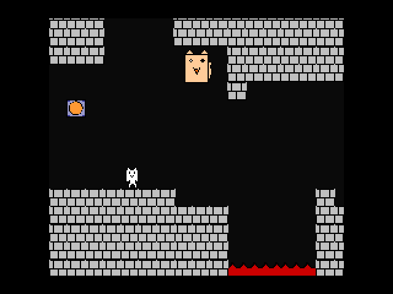
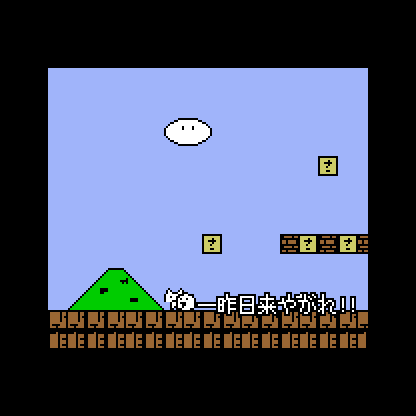
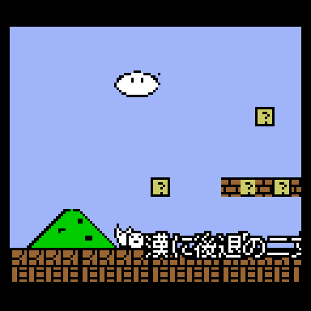
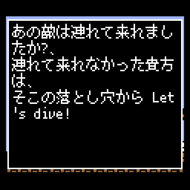

# OpenSyobonJ2ME

Syobon Action (しょぼんのアクション, Cat Mario) for Java ME phones: a MIDP 2.0 / CLDC 1.1
port of [Open Syobon Action](https://github.com/angelXwind/OpenSyobonAction) for Nokia
Series 40 and similar phones, from 128x128 up to 240x320 and 320x240 screens.

   
  

## Download

Grab the jar (and jad, if your phone wants one) from [Releases](../../releases):

| Jar | Screens | View | Sound | Size |
|---|---|---|---|---|
| `OpenSyobonJ2ME.jar` | 240x320, 320x240, 240x240 | 240x210 | music + effects | ~790 KB |
| `OpenSyobonJ2ME-lite.jar` | same | 240x210 | effects | ~220 KB |
| `OpenSyobonJ2ME-208.jar` | 208x208, 176x208, 176x220 | 160x140 | effects | ~110 KB |
| `OpenSyobonJ2ME-128.jar` | 128x128, 128x160 | 120x105 | effects | ~105 KB |

The 208 and 128 builds draw the game at a third and a quarter of the original size,
use a 10px font, wrap the hint-box text to fit, and leave out the three long jingles
(goal, 4-clear, all-clear) to stay near the 128 KB JAR limit of older Series 40 phones.
All builds need MIDP 2.0 and CLDC 1.1.

## Controls

| | Keys |
|---|---|
| Move | 4 / 6 or d-pad left/right |
| Jump | 2, 5, d-pad up or centre key |
| Jump while moving | 1 / 3 |
| Down (pipes) | 8 or d-pad down |
| Down while moving | 7 / 9 |
| Self-destruct | 0 |
| Double speed (hold) | # |
| Back to title | * |
| Pause menu | either soft key |

On the title screen, left/right picks the stage (1-1 to 3-1, plus `?`, the random
"mystery dungeon") and 5 starts.

Most S40 keypads only register one key at a time, which is why 1/3/7/9 combine a
direction with jump or down.

### Portrait or landscape

Set it under **Screen** in the pause menu:

- **Auto**: upright, using the screen as it is (portrait on 240x320, landscape on 320x240)
- **Portrait**
- **Landscape (keys right)**: turn the phone anticlockwise, keypad on the right
- **Landscape (keys left)**: turn it clockwise

In landscape the keys rotate with the picture, so whichever key points "up" on screen
jumps. The setting is saved.

## Sound

All audio is 8 kHz 8-bit mono WAV converted from the original OGGs. The dungeon track
held its loop twice, so only one copy is kept.

Plenty of S40 phones can only play one sampled sound at a time. When the phone reports
`supports.mixing=false`, the pause menu offers **music first** (default: music plays and
only the death, goal and clear jingles cut in, the same places the original stops the
music) or **effects first** (no music, every sound effect).

## Differences from the PC version

- The original 480x420 game logic runs unchanged and is drawn at 1/2, 1/3 or 1/4 scale
  depending on the build, so physics and traps behave the same everywhere.
- Sprites are redrawn for each scale by a pixel-art reduction that keeps outlines and
  small features. The player's cat is hand-drawn at every scale, and on the 128 build
  the ground, brick, question, hard and used blocks and the white blob enemy are too.
- Japanese text uses Sazanami Gothic's 12px (10px on small builds) bitmap glyphs,
  pre-rendered into the jar, so no CJK font is needed on the phone.
- Hint-block message boxes span the full width so the text fits, and stay up while
  the game waits for a key (the SDL port showed an empty box there).
- Number-key stage select is replaced by left/right on the title screen.

## Building

Needs a JDK (21 works), Python 3 with Pillow, ffmpeg, git and curl.

```sh
./build.sh            # build/OpenSyobonJ2ME.jar + .jad
LITE=1 ./build.sh     # build/OpenSyobonJ2ME-lite.jar + .jad
SCALE=3 ./build.sh    # build/OpenSyobonJ2ME-208.jar + .jad
SCALE=4 ./build.sh    # build/OpenSyobonJ2ME-128.jar + .jad
./tools/smoke.sh [jar]  # boots a jar headless in FreeJ2ME, screenshots in build/smoke/
```

The first build runs `tools/fetch-deps.sh`, which pulls into `deps/`: Open Syobon Action
(game source and assets, pinned commit), FreeJ2ME (its `javax.microedition` classes are
the API we compile against, and it runs the smoke test), and ProGuard 7.4.2.

What the build does:

1. `tools/extract_stages.py` moves the stage tile arrays out of `main.cpp` into
   `/st/*.bin`; initialisers that big would overflow Java's 64 KB method limit.
2. `tools/convert.py` translates the C++ game logic into `G.java`, and `tools/patch.py`
   applies the hand fixes on top.
3. `javac -source 8 -target 8`, refusing any non-CLDC API (StringBuilder, boxing, class
   literals), then ProGuard with `-microedition -target 1.4` shrinks and preverifies.
4. `tools/sprites.py`, `tools/font.py` and ffmpeg generate the sprites, font and WAVs
   for the chosen scale; `build.sh` writes the scale into a generated `Cfg.java`.

The runtime is in `src/java/syobon/`: `Rt` stands in for DxLib/SDL, `Cv` is the canvas
(main loop, keys, rotation, pause menu), `Snd` handles MMAPI audio and `Font` draws the
bitmap font.

GitHub Actions builds all four jars on every push and attaches them to a release when a
`v*` tag is pushed.

## Credits

- Syobon Action: Chiku (ちく). If you pass this around, credit Chiku.
- Open Syobon Action (SDL port): Mathew Velasquez; fork by Karen (angelXwind)
- Sazanami Gothic font: Electronic Font Open Laboratory (/efont/) and contributors
- J2ME port: Jecka

The game's music is taken from other games, as in the original release.
